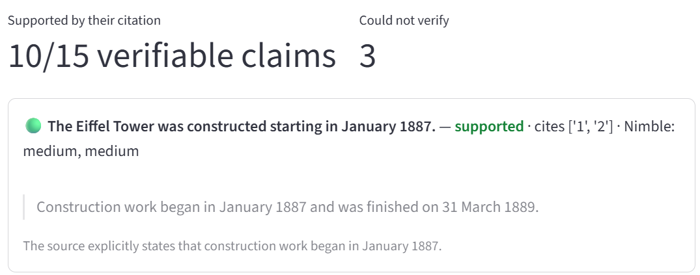
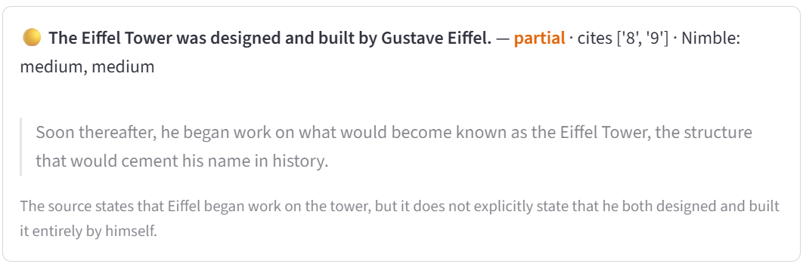
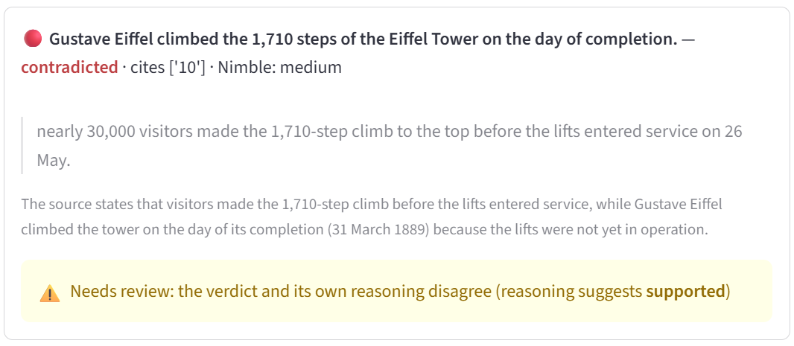

# Citation Checker

**Does each cited source actually support the claim?**

AI answer engines attach citations to their answers, but a citation is only useful if the page really says what the answer claims. Citation Checker takes an AI answer with `[n]` citations, fetches every cited page live, splits the answer into atomic claims, and checks each claim against the source it cites, quoting the evidence.

It can also audit a **Nimble Web Search Agent** end to end: ask a question, get Nimble's cited answer and its own confidence grades, then independently verify every citation.

Built solo in one day at the AI Engineer NYC Hackathon (October 11, 2026).



## How it works

1. **Answer** (optional): a Nimble Web Search Agent answers a question with `[n]` citations and a per-claim confidence grade (`effort="low"`, about 15 seconds).
2. **Fetch**: Nimble Extract fetches the live text of each cited page (with JavaScript rendering), cleaned with `trafilatura` and cached locally.
3. **Split**: Gemini breaks the answer into atomic, self-contained claims, keeping each claim's citation numbers and qualifiers ("himself", "only", "about").
4. **Judge**: Gemini labels each claim against its cited source, using only the source text, and quotes the sentence it relied on.
5. **Check the judge**: code verifies that the quoted evidence actually appears in the source, and **Claude**, a model from a different family, checks that each negative verdict matches the judge's own reasoning. Pages that could not be fetched properly (too short, or identical text returned for different URLs) are marked `unverifiable` instead of blaming the source.

The Streamlit app has three modes: ask a Nimble agent and audit its answer live, check a pasted answer, or replay a saved run.

## Verdict labels

Every label is about **the cited page**, not about the real world. A claim can be true and still be `not_found` if the page it cites never mentions it.

| Label            | Meaning                                                                   |
| ---------------- | ------------------------------------------------------------------------- |
| `supported`    | The cited page states the claim (same fact, possibly in different words)  |
| `partial`      | The page supports part of the claim, or something close but less specific |
| `contradicted` | The page says something incompatible (a different number, person or date) |
| `not_found`    | The page was read, but says nothing about the claim                       |
| `unverifiable` | The page could not be fetched properly, so the claim could not be checked |
| `no_citation`  | The claim has no citation at all                                          |

**Labeling standard:** the same fact in different words counts as `supported` ("centerpiece" vs. "main attraction"); a different fact does not ("entrance arch" vs. "centrepiece"). Minor rounding in unit conversions (1,082 vs. 1,083 feet) counts as `supported`. A claim that follows directly from what the page says counts as `supported` (the climb to the top is 1,710 steps, and Eiffel climbed to the top). When a page contains the pieces of a claim but only plausibly links them, the claim is `partial` (Eiffel had a company, and Eiffel worked on the tower, but the page never says the company built it).

**Coherence flag:** a second LLM pass (Claude) checks whether the judge's label matches its own reasoning. It only runs on negative verdicts, to save API calls.

| Flag            | Meaning                                                                                  |
| --------------- | ---------------------------------------------------------------------------------------- |
| `not checked` | The check did not run: the verdict was`supported`, `unverifiable` or `no_citation` |
| `coherent`    | The check ran, and the label matches the judge's reasoning                               |
| `FLAGGED`     | The check ran, and the label contradicts the judge's reasoning, so it needs human review |

`coherent` only means the label follows from the reasoning, not that the reasoning is right. For example, "1,083 feet" was `contradicted` with coherent reasoning ("the source says 1,082"), but the judge was being too literal; only human labels caught that.

## What I found

### 1. Planted errors are caught, with verifiable evidence

On a hand-written answer about the Eiffel Tower with three planted errors (450 m tall, "designed by Gustave Eiffel himself", "about 5 million visitors"), all three were marked `contradicted`, the true claims were `supported`, and every quoted piece of evidence was found verbatim in the source.

### 2. Auditing a Nimble agent: right answers, imperfect citations

Two live runs of the same question ("When was the Eiffel Tower built, how tall is it, and who designed it?"):

| Run | Nimble's confidence | Claims | Supported by their citation | Could not verify |
| --- | ------------------- | ------ | --------------------------- | ---------------- |
| A   | high (all claims)   | 23     | 15 of 18 verifiable         | 5                |
| B   | medium (all claims) | 18     | 10 of 15 verifiable         | 3                |

The same question produced a different answer, different sources (9 vs. 10) and a different confidence grade, which is a good argument for auditing every answer rather than trusting a single run.

Notable cases:

- **Right answer, stale citation.** The answer said 330 m (correct since 2022), but one cited page (WorldAtlas) says 324 m including antennas, an outdated figure. Nimble rated that citation high confidence.
- **Source labels.** In run A, all 9 sources were labeled `official`, including a travel site and Wikipedia.
- **Fetch failures look like "not found".** One page returned 41 characters (blocked), and two different pages on the official site returned the same 4,545-character template. Before adding the `unverifiable` status, 5 of 6 "not found" verdicts came from these pages, not from the answer. Checking some `unverifiable` claims by hand showed their pages did support them, so fetch failures hide real support.



### 3. The judge itself is unreliable in specific ways

- **Too lenient:** "the tower was the *entrance arch* of the fair" was `supported` by a sentence saying it was the *centrepiece*.
- **Too literal:** "1,083 feet" was `contradicted` because the source says 1,082 feet, a unit-conversion rounding difference (330 m ≈ 1,082.7 ft).
- **Verdict contradicts its own reasoning:** "Eiffel climbed the 1,710 steps on the day of completion" was labeled `contradicted`, while the judge's explanation says Eiffel did climb on foot that day. The coherence check flags it for review.



### 4. Judge stability (small pilot)

Same claims and sources; only the judge changes (repeat run, three prompt wordings, and a stronger model). On the 6 claims of the planted example:

- The fast model (`gemini-3.5-flash-lite`) agreed with itself 100% across a repeat run and three prompt wordings.
- The stronger model (`gemini-3.8-flash`) disagreed on exactly one claim, the ambiguous "entrance arch", marking it `partial`. (One stronger-model call failed on quota and was excluded.)
- On real agent answers, a borderline claim ("designed by a team led by Eiffel") flipped from `not_found` to `partial` between two runs with identical inputs.

Takeaway: **a stable judge is not necessarily an accurate one, and human labels show where it fails.** The fast judge was consistently lenient on the one ambiguous claim, and instability concentrates on borderline claims, where the verdict matters most. Even the claim splitter varies (21 vs. 23 claims for the same answer).

### 5. Judge accuracy against human labels

I labeled the 15 verifiable claims of the saved agent run myself, using the standard in "Verdict labels" above.

| Judge said       | Claims       | I agreed           |
| ---------------- | ------------ | ------------------ |
| `supported`    | 10           | 10                 |
| `partial`      | 3            | 2                  |
| `contradicted` | 2            | **0**        |
| **Total**  | **15** | **12 (80%)** |

**Every error was the same kind: the judge was too strict.** All three were claims the source actually supports:

- "1,083 feet" (`contradicted`): the source says 1,082, a rounding difference in the unit conversion.
- "Eiffel climbed the 1,710 steps" (`contradicted`): the page gives 1,710 steps to the top and says Eiffel climbed to the top that day.
- "Gustave Eiffel is a French civil engineer" (`partial`): the page says he was born in France and worked as an engineer.

So on this run, the judge never approved a claim it shouldn't have; its failures were all false alarms. That points to a concrete fix: a second opinion before any negative verdict is shown.

### 6. Checking the judge with a different model family

The coherence check was first run with Gemini, the same model family as the judge. It flagged 3 verdicts: 2 real errors and 1 false flag. Because a same-family checker can share the judge's blind spots, I re-ran it with **Claude (`claude-haiku-5-5`)**:

|                                                      | Gemini checker | Claude checker   |
| ---------------------------------------------------- | -------------- | ---------------- |
| Verdicts flagged                                     | 3              | 2                |
| Flags that were real judge errors                    | 2              | **2**      |
| False flags                                          | 1              | **0**      |
| Suggested labels matching mine (5 reviewed verdicts) | 3 of 5         | **4 of 5** |

For comparison, the judge's own labels matched mine on 2 of those 5. Neither checker caught the over-strict "1,083 feet" verdict, whose reasoning was internally consistent. Small sample, but it supports using a different model family to check a judge, as a review signal rather than a replacement for human labels.

**Caveats:** one annotator, 15 claims. Two of my labels were revised after re-reading the pages, and one of those after seeing the Gemini checker's suggestion, which risks anchoring; a cleaner protocol fixes human labels before looking at any model output. This is a pilot, not a benchmark. `labels.csv`, `score_labels.py` and `compare_checker.py` are in the repo.

## Engineering notes

- Gemini free tier: 15 requests/minute on the fast model and 20/day on the stronger one, plus 503/504 errors under load. Handled with retries and backoff, a 3-minute timeout, page caching, and the fast model as the default.
- Every live run is saved (`last_run.json`), and a protected demo run (`demo_run.json`) can be replayed instantly.
- Nimble's per-claim `excerpts` came back empty at `effort="low"`, so auditing Nimble's own quotes is left for future work.

## Related work

Nimble's cookbook [Fact-check documents with LiteLLM and Nimble](https://www.nimbleway.com/cookbooks/fact-check-documents-with-litellm) searches for **new** evidence for each claim. Citation Checker instead checks whether the **citations an answer already gave** hold up, audits the agent's own confidence grades, and tests whether the judge itself is reliable.

## Next steps

- More answers and more annotators, to measure judge accuracy with confidence intervals and inter-annotator agreement.
- Reduce false contradictions: a rounding-tolerance rule for numbers, and a cross-family second opinion before any negative verdict is shown.
- Compare full judges across model families, not just checkers.
- Trim each page to the passage relevant to the claim (fewer tokens, fewer rate-limit hits).
- Audit Nimble's verbatim excerpts at higher effort levels.

## Run it

```bash
python -m venv .venv
.venv\Scripts\Activate.ps1        # Windows (PowerShell)
pip install -r requirements.txt
```

Create a `.env` file:

```
GEMINI_API_KEY=...
NIMBLE_API_KEY=...
ANTHROPIC_API_KEY=...   # used by the coherence checker (Claude)
```

Then:

```bash
streamlit run app.py
```

| File                                                                              | What it does                                                                                                                 |
| --------------------------------------------------------------------------------- | ---------------------------------------------------------------------------------------------------------------------------- |
| `app.py`                                                                        | Streamlit interface (live agent audit, pasted answer, saved run)                                                             |
| `nimble_agent.py`                                                               | Runs a Nimble Web Search Agent and returns answer, sources and confidence                                                    |
| `fetch.py`                                                                      | Fetches cited pages with Nimble Extract, with a cache and a fallback                                                         |
| `claims.py`                                                                     | Splits an answer into atomic claims (Gemini)                                                                                 |
| `judge.py`                                                                      | Labels each claim against its source (Gemini), verifies the quoted evidence, and checks verdict-reasoning coherence (Claude) |
| `llm.py`                                                                        | Gemini and Claude clients, with retries and timeouts                                                                         |
| `pipeline.py`                                                                   | Runs the full check, flagging unreadable sources                                                                             |
| `stability.py`, `prompts.py`                                                  | Judge stability analysis across prompts and models                                                                           |
| `audit_agent.py`                                                                | Compares our verdicts with Nimble's confidence for a saved agent run                                                         |
| `add_coherence.py`                                                              | Runs the coherence check on a saved run                                                                                      |
| `export_labels.py`, `score_labels.py`, `compare_checker.py`, `labels.csv` | Human labels, judge accuracy, and checker comparison                                                                         |
